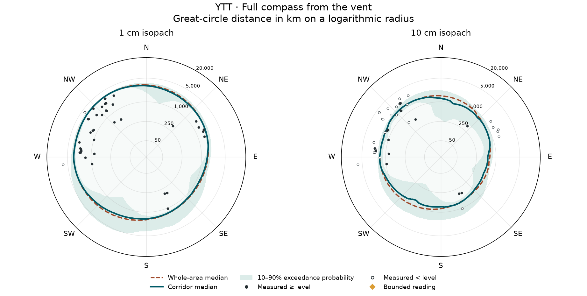

# YTT · Bayesian nested corridors

The principal bulk volume is **1,245 km³**, the whole-Earth integral of the median-thickness map. The conditional 95% interval for total fallout volume is **771–3e+03 km³** across complete posterior draws. **Numerical warning on the fitted deposit distribution.**

Each circle shows a measurement. Bounded sites take the colour of their stated limit. The curve counts every patch at or above each thickness. The volume also includes thinner fallout beyond the 0.5 cm line. [Thickness and cumulative area](thickness-area.csv) · [Map integral, resolution and source hashes](deposit.json)

Solid segments cross locally bracketed triangles with at least 90% posterior crossing probability. [Whole-Earth context](world.png) · [Local brackets](local-brackets.csv.gz) · [Complete contour checks](support.json)

The buffered geographic score is 1.429 for the corridor and 1.507 for the whole-area sensitivity. Lower scores indicate better predictions at withheld sites. The corridor’s 95% predictive intervals cover 45 of 46 exact withheld readings. 3 of 4 geographic fits passed their sampling checks. The full-data proposal and importance check retained a warning, the final volume populations retained a warning, and the integration check passed. The shared screen accepted a complete contour band under 0 policies. [Prediction scores and row identities](report.json) · [Full fit diagnostics](full.json)

## Where the volume lies

The full-compass view includes all bearings through the antipode. Its logarithmic distance scale makes the proximal flanks visible. Areas in the table use the physical equal-area integral.

| Compass sector | Exact sites | Bounded sites | Corridor 1 cm area (km²) | Whole-area 1 cm area (km²) | Corridor conditional 95% volume interval (km³) |
|---|---:|---:|---:|---:|---:|
| N | 0 | 0 | 3,430,322 | 3,703,034 | 70.9–511.5 |
| NE | 5 | 0 | 1,942,358 | 2,068,917 | 70.1–219.5 |
| E | 1 | 0 | 910,363 | 953,976 | 32.6–112.7 |
| SE | 2 | 0 | 608,392 | 660,741 | 22.0–220.1 |
| S | 1 | 0 | 952,742 | 1,128,901 | 24.2–616.4 |
| SW | 0 | 0 | 2,054,526 | 2,439,425 | 24.3–719.0 |
| W | 11 | 0 | 3,826,045 | 3,905,238 | 191.1–446.3 |
| NW | 26 | 0 | 4,318,766 | 4,419,929 | 240.9–456.5 |

At 1 cm, the corridor median map encloses 18,043,514 km² and the whole-area sensitivity encloses 19,280,161 km². Of these, 16,891,811 and 18,128,458 km² fall outside the retained exact-site triangles. An unsampled sector can contain ash. Its allocation depends on the assumed continuation.

The prior assigns 25% to continuation across all bearings. The remaining probability spans three fan widths and three down-range extensions. The fitted probability of whole-bearing continuation is 25.0%. The widths and extensions are shared structural assumptions. A bound supplies a likelihood event. Only positive evidence supplies a potential dispersal corridor.

[Volume and sector draws](volume-budget.npz) · [Complete field draws](full.npz) · [Areas, assumptions, bounds and diagnostics](report.json)

## Structural uncertainty

[Corridor and whole-area maps on a common scale](paired-isopachs.png)

| Prior probability of broad continuation | Conditional 95% volume interval (km³) |
|---:|---:|
| 10% | 754.3–2,855.6 |
| 25% | 771.0–3,000.8 |
| 50% | 796.9–3,223.7 |
| 75% | 858.6–3,277.0 |

The prior odds vary under the same observed likelihood. The numerical report also gives the volume by individual corridor law where the saved draws resolve it.

[Whole-area sensitivity report, posterior and diagnostics](../nested-whole-area/README.md)
