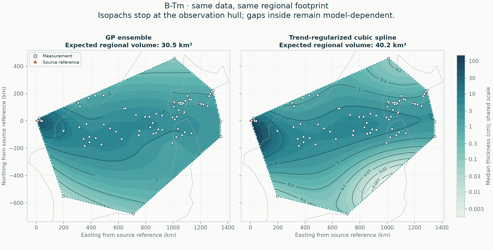

# B-Tm: current regional comparison

**GP ensemble and automatic cubic spline are reported as peers.** Both use the same accepted data, geographic holdouts and observation hull.

[Read the full comparison](comparison/README.md) · [Compare all six eruptions](../regional-methods/README.md) · [Method definitions](../../docs/METHODS.md)

84 exact measurements and 0 lower bounds; regional area 963,645 km².

| Quantity | GP ensemble | Cubic spline |
|---|---:|---:|
| Expected regional bulk fallout (km³) | 30.46 | 40.16 |
| Outer equal-region negative log score ↓ | 1.331 | 1.814 |

These volumes cover only the observation hull. It can include unsampled gaps and exclude proximal deposits; it is not total eruption volume or dense-rock equivalent. Conditional intervals omit fitted-parameter and selection uncertainty. Read withheld coverage and geographic-deletion sensitivity in the full report.

## Earlier calculations

[GP-only global ensemble](global/stacked/README.md) · [Earlier selected GP](global/selected/README.md) · [Rectangular regional history](regional/README.md)

Historical numerical artifacts retain their original method, source hashes and integration domain. They are not used to rank the current regional methods.
