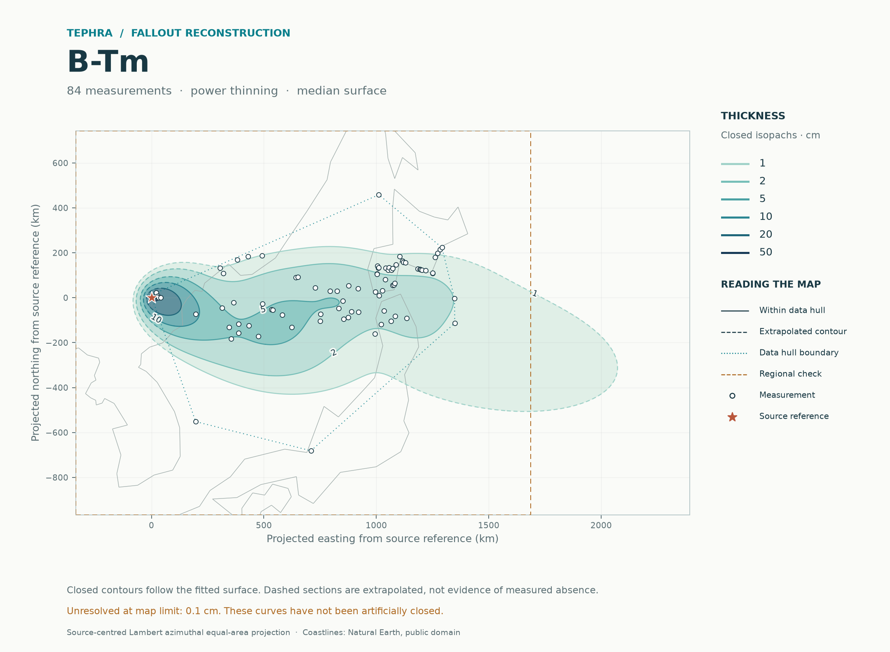
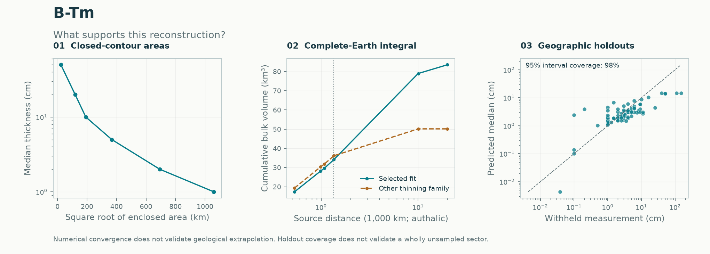

# B-Tm: deposit reconstruction

**Method: selected Gaussian process (`selected`) · current complete-Earth calculation.** [Method guide](../../../../docs/METHODS.md) · [Report catalogue](../../../README.md)

The analysis used **84 thickness measurements** and 0 documented upper limits and 0 lower bounds, excluding 7 legacy pseudo rows. Spatial validation selected the power thinning family within the directional-trend-plus-spatial-residual model.

## Primary result: complete-Earth fallout

**Expected global bulk fallout: 83.5 km³.** The integral covers the complete WGS84 surface, independently of the display extent or diagnostic rectangle. Numerical refinement and angular-phase checks passed.

The integral of the global median thickness surface is 67.0 km³. 59.1% of expected volume lies beyond the farthest sampled source-distance (1,355 km on the authalic sphere); 5.5% lies on the opposite hemisphere. These fractions describe extrapolation, not measured deposition.

The other fitted thinning family gives **50.2 km³** globally. This comparison tests tail assumptions; it is not a confidence interval.

The result is conditional on the fitted thickness model and its global extrapolation. No global probability interval is estimated. The regional simulation intervals below or in JSON do not apply globally. It is bulk fallout volume; DRE and other eruption products require separate evidence. [Global numerical record](global_volume.json) · [Global volume table](global_volume.csv)

## Historical regional diagnostic

| Result | Estimate |
|---|---:|
| Expected bulk volume in the stated region | 40.1 km³ |
| Integral of the median thickness surface | 36.3 km³ |
| Expected volume outside the observation hull | 28% |
| Expected volume after doubling both region widths | 53.6 km³ |
| Last numerical refinement change | 0.03% |

Closed median isopachs were resolved at 1, 2, 5, 10, 20, 50 cm. Levels 0.1 cm remain beyond the map limit and were not artificially closed.

Nested geographic holdouts covered 98% of exact measurements with nominal 95% intervals; natural-log RMSE was 0.88.

| Geographic holdout metric | Value |
|---|---:|
| Negative log score (lower is better) | 1.275 |
| Equal-region negative log score | 1.275 |
| Mean 95% interval width (natural-log cm) | 4.062 |

The regional table contains finite-region **bulk deposit volumes**, not total erupted volumes or DRE. The median-surface integral is not the median of total random volume. The stated equal-area rectangle is easting -337.173 to 1685.86 km and northing -966.315 to 743.393 km from the supplied source reference. Numerical convergence passed the 0.5% criterion. Unsampled sectors and distant tails remain assumption-dependent. Uncertainty model: conditional Gaussian. Fitted-parameter uncertainty is not integrated. Input provenance and preservation were not independently audited.

[Numerical report](report.json) · [Map PDF](isopachs.pdf) · [Volume table](volume_summary.csv) · [Contours](isopachs.geojson)

