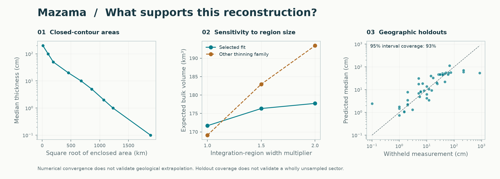

# Mazama: deposit reconstruction

The analysis used **45 thickness measurements** and 0 documented upper limits, excluding 7 legacy pseudo rows. Spatial validation selected the **exponential** thinning family within the existing directional-trend-plus-spatial-residual model.

| Result | Estimate |
|---|---:|
| Expected bulk volume in the stated region | 171.7 km³ |
| Integral of the median thickness surface | 159.0 km³ |
| Expected volume outside the observation hull | 23% |
| Expected volume after doubling both region widths | 177.7 km³ |
| Last numerical refinement change | 0.00% |

Closed median isopachs were resolved at 0.1, 1, 2, 5, 10, 20, 50, 100, 200 cm. Extrapolated contour sections are dashed on the map.

Nested geographic holdouts covered 93% of observations with nominal 95% intervals; natural-log RMSE was 0.91.

These are finite-region **bulk deposit volumes**, not total erupted volumes or DRE. The median-surface integral is not the median of total random volume. The default region comes from observation coordinates plus 25% padding; exact bounds and alternatives are in the full report. Numerical convergence passed the 0.5% criterion. Unsampled sectors and distant tails remain assumption-dependent, and conditional intervals omit fitted-parameter and model uncertainty. Input provenance and preservation were not independently audited.

[Numerical report](report.json) · [Map](isopachs.pdf) · [Volume table](volume_summary.csv) · [Contours](isopachs.geojson)

Historical calculation; source hashes and settings are retained in report.json.
