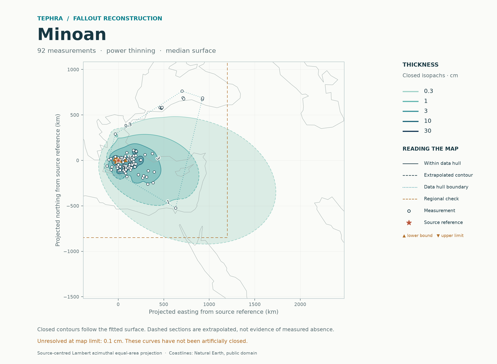
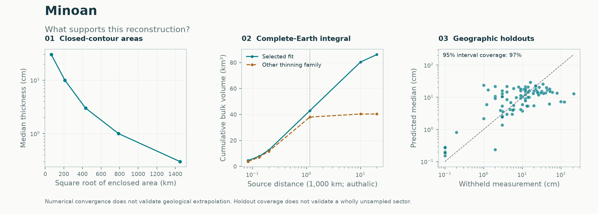

# Minoan: complete-Earth fallout volume

**Expected global bulk fallout: 86.1 km³**, conditional on the selected thickness model. The calculation covers the complete physical WGS84 Earth and is independent of map extent, contour levels and any user-selected calculation rectangle. **More than half of the selected global estimate lies beyond the farthest observation. Treat this as a strongly extrapolation-dependent model estimate.**

A **single combined fallout field** includes all accepted Plinian and co-ignimbrite fans: 92 exact thicknesses and nine incomplete-core lower bounds. Identified turbidites are excluded. [Source audit](../../data/audits/Minoan/README.md).

[Selected calculation](global/selected/README.md) · [Ensemble calculation](global/stacked/README.md) · [All-eruption comparison](../global-fallout/README.md) · [Method](../../docs/GLOBAL_VOLUME.md) · [Earlier regional analysis and source discussion](REGIONAL_REPORT.md)



## What changes when the region choice is removed

| Quantity | Result |
|---|---:|
| Selected global expected bulk fallout | **86.1 km³** |
| Ensemble global expected bulk fallout | 81.3 km³ |
| Other fitted thinning family, globally | 40.3 km³ |
| Selected global median-surface integral | 53.6 km³ |
| Previous selected regional expectation | 44.2 km³ |
| Global expected volume beyond farthest observation | 50.1% |
| Global expected volume on opposite hemisphere | 6.6% |
| Four geographic-deletion/refit volumes | 59.0–92.8 km³ |

The other-family and deletion comparisons are sensitivities, **not confidence intervals**. A different fitting family can give a very different global total even when both integrals converge. The selected fit and its predictions are unchanged by the integration revision. The ensemble remains an evaluated alternative; this release does not reselect a tail to obtain a preferred volume.

The source-distance diagnostic uses arcs on the equal-area authalic sphere; the farthest accepted observation is 1,156 km from the source. The map's ochre rectangle now marks only the separate regional check. The entire Earth is integrated, including regions outside the displayed map and where no contour closes.

The [source paper](https://doi.org/10.1038/s41467-023-38176-3) reports 47.8–55.5 km³ of combined bulk fallout. The selected global estimate exceeds that range, whereas the exponential comparison is below it. Shared measurements and large tail-model disagreement prevent treating either agreement or disagreement as independent validation. The paper's total-eruption DRE headline is a different quantity.

## Validation and remaining limits

Both global integrals pass radial/angular refinement and shifted-grid checks. The nominal numerical tolerance is 0.1%; this is an empirical integration check, not a statistical uncertainty interval. Selected-method geographic holdouts have negative log score 1.443, natural-log RMSE 1.095, and nominal 95% observation coverage 96.7%. These observation checks do not validate wholly unsampled sectors or a global volume.



The middle panel accumulates volume across all source distances to the antipode; its dotted vertical line marks the farthest observation. The total uses the full physical Earth in both fitting-family curves.

**No global probability interval is estimated.** Conditional intervals in the regional calculation remain specific to that rectangle. Fitted-parameter, source-position, preservation and model-choice uncertainty are not fully propagated. The global extension of the planar trend/covariance is an explicit extrapolation assumption, especially far from the data. These are bulk fallout estimates; DRE and other eruption products require additional evidence.

## Reproduce

```sh
tephra-isopachs fit Minoan --output results/minoan-global --nested-cv --grid 128 --draws 1500
python -m benchmarks.global_fallout --output results/global-fallout
```

The second command reproduces both methods for all six eruptions, geographic deletions and known-truth trials. Accepted input bytes and existing historical report artifacts are preserved. [Numerical global record](global/selected/global_volume.json) · [Full run and code hashes](global/selected/report.json).
