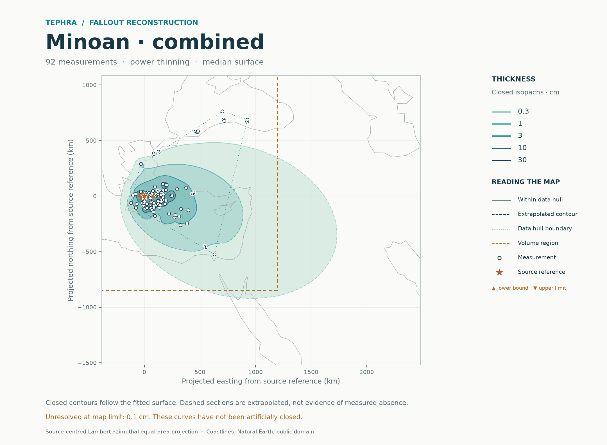
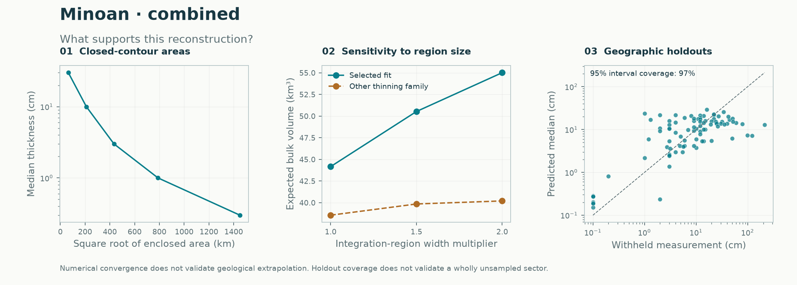

# Minoan eruption: all fallout fans together

**Historical regional calculation · Gaussian-process model.** These volumes use a stated rectangle. [Current eruption report](../README.md) · [Report catalogue](../../README.md). The source-selection sensitivities below remain useful; their regional headlines are not the current global headline.

**One total-fallout field fitted to 92 exact thicknesses and nine lower bounds gives an expected regional bulk volume of 44.2 km³.** The calculation combines Plinian and co-ignimbrite fallout at each location before fitting. It does not fit separate fans and add their volumes. Identified turbidite material is excluded.

The result remains sensitive to unsampled outer sectors: doubling both integration-region widths raises expected volume to **55.0 km³**, a 24.6% increase. These are finite-region estimates, not an established whole-deposit volume or the total erupted volume.

[Source audit](../../../data/audits/Minoan/README.md) · [Main numerical report](combined_selected/report.json) · [Main calculation](combined_selected/README.md) · [Method decision](method_decision.json) · [Every held-out site](site_holdouts.csv)



## What enters the joint calculation

The unchanged Supplementary Data 2 workbook from [Karstens et al. (2023), *Revised Minoan eruption volume as benchmark for large volcanic eruptions*](https://doi.org/10.1038/s41467-023-38176-3) contains 105 records. All records, source labels and decisions remain in the [selection manifest](../../../data/audits/Minoan/selection_manifest.csv).

For complete deposits, the response is the reported total minus any identified numeric turbidite thickness. For example, POS513-20 contributes 49 − 15 = 34 cm. Unpartitioned totals remain total-fallout observations; missing phase entries are not invented. A blank turbidite cell means none identified in this compilation, rather than independent proof of absence.

Nine incomplete cores contribute documented minima: their recovered Plinian plus co-ignimbrite material. The likelihood uses the probability that thickness exceeds each minimum. It does not turn a lower bound into an exact thickness. Candidate selection and independent geographic validation use the same survival-probability scoring. Bounds condition the spatial field; trend and covariance estimates retain the existing two-stage procedure based on exact measurements. All intervals remain conditional on fitted parameters.

One unknown thickness is omitted, two internally conflicting totals are reserved for sensitivity cases, and two source records with identical coordinates and thickness supply one location constraint. This leaves **101 distinct locations**. No pseudo-observations, hand-drawn fan boundaries, assumed phase fractions or fabricated non-detections enter the calculation. The model can describe multiple contour components through its spatial residual field, but sparse measurements do not guarantee recovery of every unobserved lobe.

## Method comparison on the same observations

Both methods use identical four-fold geographic holdouts, three inner folds and a 10 km exclusion buffer. Every withheld prediction is made after refitting on training observations. Scores include exact measurements and censored events; RMSE and interval coverage use only the 92 exact measurements.

| Metric | Established `selected` | Experimental `stacked` |
|---|---:|---:|
| Mean negative log score; lower is better | **1.443** | 1.480 |
| Equal-region negative log score | **1.443** | 1.481 |
| Natural-log RMSE | **1.095** | 1.121 |
| Nominal 95% observation coverage | 89/92 (96.7%) | 87/92 (94.6%) |
| Mean interval width, natural-log cm | 5.210 | 4.943 |
| Expected regional bulk volume, km³ | 44.2 | 39.4 |

**Retain `selected` as the default.** It has better predictive scores and point error here. The ensemble's coverage is closer to nominal and its intervals are narrower, but this does not establish an overall improvement. Four folds on one deposit are not a significance test or evidence of universal superiority. The ensemble remains available for comparison. Its extra observation-discrepancy adjustment also worsens the predictive score, to 1.494, and remains a diagnostic.

Coverage alone is reassuring only in a limited sense: intervals are broad. The established model misses three measured thicknesses:

| Map ID / core | Observed, cm | Holdout median, cm | 95% observation interval, cm |
|---|---:|---:|---:|
| 53 / TR172-29 | 1 | 23.6 | 1.55–359.6 |
| 38 / TR171-1 | 122 | 7.2 | 0.43–120.7 |
| 57 / V10-50 | 212 | 12.9 | 1.02–163.8 |

These failures and the smoothing of thick local deposits remain visible in the [site-level results](site_holdouts.csv). They are not corrected using the withheld values.



## Volume, source sensitivity and the published benchmark

All cases integrate the same equal-area rectangle: easting −400 to 1,200 km and northing −850 to 1,100 km from the Santorini reference. This region is reproducibly derived from the accepted observations and source location with 25% padding and outward rounding to 25 km. It is not a mapped deposit boundary.

| Joint input and method | Exact / lower bounds | Expected bulk volume, km³ | Median-surface integral, km³ |
|---|---:|---:|---:|
| [Main, selected](combined_selected/README.md) | 92 / 9 | **44.17** | 29.33 |
| [Main, stacked](combined_stacked/README.md) | 92 / 9 | 39.41 | 29.61 |
| [Omit incomplete cores](exact_only_selected/README.md) | 92 / 0 | 42.77 | 28.09 |
| [Resolve two conflicts using component sums](component_conflicts_selected/README.md) | 94 / 9 | 45.79 | 30.34 |
| [Resolve two conflicts using reported totals](total_conflicts_selected/README.md) | 94 / 9 | 47.32 | 30.87 |
| [Omit POS513-41](without_pos513_41_selected/README.md) | 91 / 9 | 44.03 | 29.21 |

POS513-41 is 32 cm in the workbook, whereas Supplementary Note 1 describes a 66 cm sequence. Its omission tests this unresolved source discrepancy without inventing a replacement value. The sensitivity cases quantify specific input choices; their different observations and folds mean their scores cannot establish a method improvement. See [all metrics](comparison.csv).

About **31.7%** of expected main-region volume lies outside the observation hull. The median-surface integral, 29.3 km³, is smaller than the expected-volume integral because the latter includes conditional lognormal uncertainty. It is not the median of total random volume. The numerical integration passes the 0.5% refinement criterion, changing by 0.15% on its final refinement. Numerical convergence does not resolve geological extrapolation.

The paper reports 38.6–46.3 km³ of Plinian fallout plus 9.2 km³ of co-ignimbrite fallout: **47.8–55.5 km³ combined bulk fallout**. Our main-region estimate is below that range; the expanded-region result falls within it. The paper's 34.5 ± 6.8 km³ headline is **total-eruption dense-rock equivalent**, including other deposit classes, and is not the corresponding comparison. The paper and this reconstruction share source measurements, so agreement is a method comparison, not validation against independent truth. [Published volume comparison](benchmark_comparison.json)

The selected power-law trend reaches its minimum-decay constraint. Its expanded-region estimates are 50.5 and 55.0 km³; alternative exponential tails give 39.9 and 40.2 km³ in those same regions. This spread, unresolved 0.1 cm contours beyond the map limit and growing out-of-hull contribution show that outer-tail assumptions matter. No infinite-domain volume is reported, and no missing contour is artificially closed.

For context only, applying the paper's 55–63% porosity bracket uniformly to the 44.2 km³ regional estimate would give 16.3–19.9 km³ DRE. This is an assumed conversion sensitivity, not a confidence interval, a separate measured result or a total-eruption estimate. No DRE conversion is applied to the exported bulk-volume tables.

## Reproduce and interpret

```sh
python -m pip install '.[test]'
python -m benchmarks.minoan --output results/minoan
python -m pytest -q
```

The command verifies the original workbook, all five accepted input selections and the full manifest before running six joint fits. Settings are recorded: 4 outer/3 inner folds, 10 km buffer, 128×128 prediction grid, 481×481 contour grid, 48×48 joint-volume grid, 1,500 draws, seed 1729 and maximum map coordinate 3,000 km. Adaptive integration uses separate refinements. Each numerical report records input hashes, source-code hashes, versions, settings and predictions. [Verification record](validation.json)

**51 automated checks passed.** The four existing real-data benchmarks and 30 synthetic trials reproduce their previous numerical results exactly. Clean installation was checked outside the checkout, including both audited datasets and the absence of the retired atlas/browser modules. Six compact report folders contain Markdown, PNG/PDF maps, diagnostic PNGs, GeoJSON, CSV tables and numerical JSON. Dense arrays and SVGs are reproducible local outputs.

Remaining limitations include conditional rather than full parameter uncertainty, the two-stage censored fit, preservation and compaction, uncertain historical vent location, source-table conflicts and nominal Black Sea 0.1 cm entries whose original publications were not independently re-audited. These systematic assumptions are recorded explicitly; reproducibility does not eliminate them.
