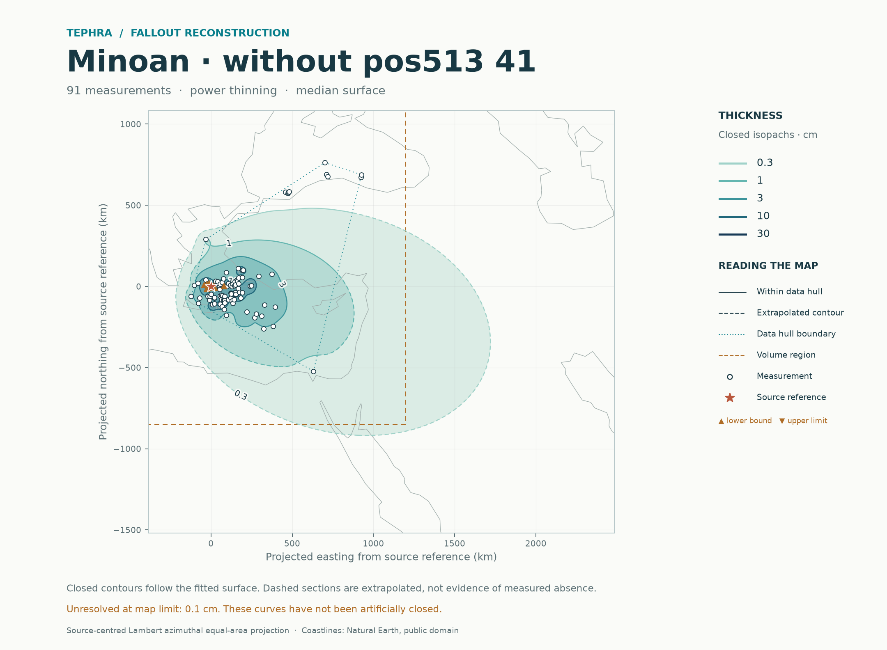
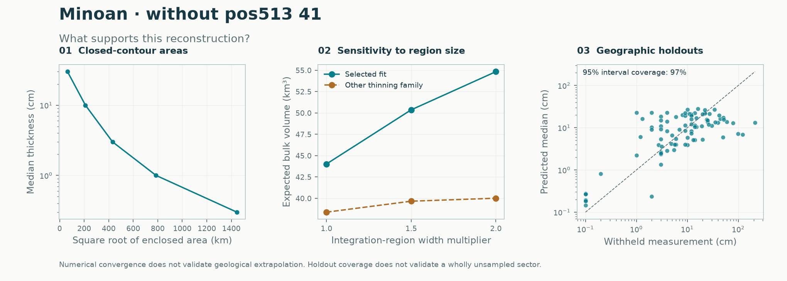

# Minoan · without pos513 41: deposit reconstruction

**Method: selected Gaussian process (`selected`) · historical regional calculation.** [Method guide](../../../../docs/METHODS.md) · [Report catalogue](../../../README.md)

The analysis used **91 thickness measurements** and 0 documented upper limits and 9 lower bounds, excluding 0 legacy pseudo rows. Spatial validation selected the power thinning family within the directional-trend-plus-spatial-residual model.

| Result | Estimate |
|---|---:|
| Expected bulk volume in the stated region | 44.0 km³ |
| Integral of the median thickness surface | 29.2 km³ |
| Expected volume outside the observation hull | 32% |
| Expected volume after doubling both region widths | 54.8 km³ |
| Last numerical refinement change | 0.15% |

Closed median isopachs were resolved at 0.3, 1, 3, 10, 30 cm. Levels 0.1 cm remain beyond the map limit and were not artificially closed.

Nested geographic holdouts covered 97% of exact measurements with nominal 95% intervals; natural-log RMSE was 1.11.

| Geographic holdout metric | Value |
|---|---:|
| Negative log score (lower is better) | 1.452 |
| Equal-region negative log score | 1.452 |
| Mean 95% interval width (natural-log cm) | 5.184 |

These are finite-region **bulk deposit volumes**, not total erupted volumes or DRE. The median-surface integral is not the median of total random volume. The stated equal-area rectangle is easting -400 to 1200 km and northing -850 to 1100 km from the supplied source reference. Numerical convergence passed the 0.5% criterion. Unsampled sectors and distant tails remain assumption-dependent. Uncertainty model: conditional Laplace. Fitted-parameter uncertainty is not integrated. Input selection preserves the supplied audit: Combined main selection minus map ID 24, whose workbook and Supplementary Note 1 describe different total sequences. Geological qualifications remain in the source audit; this model run does not re-audit the original publications.

[Numerical report](report.json) · [Map PDF](isopachs.pdf) · [Volume table](volume_summary.csv) · [Contours](isopachs.geojson)

