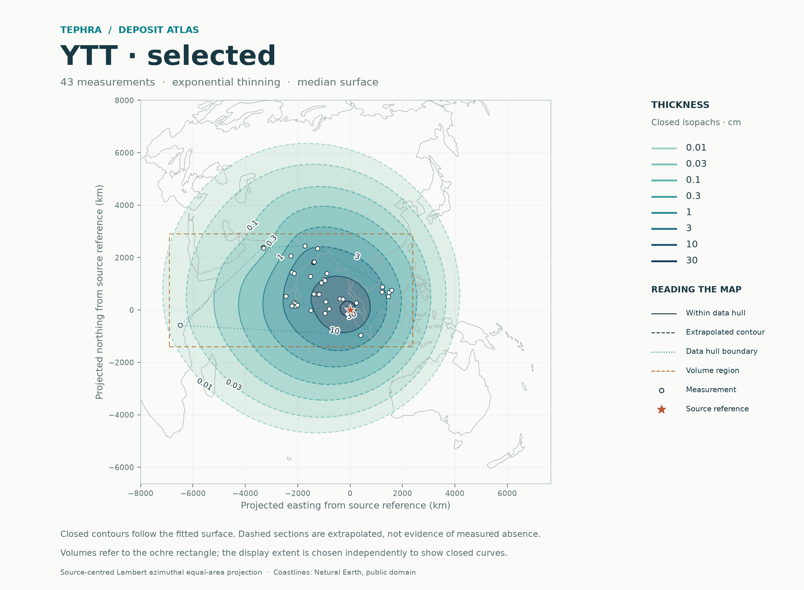
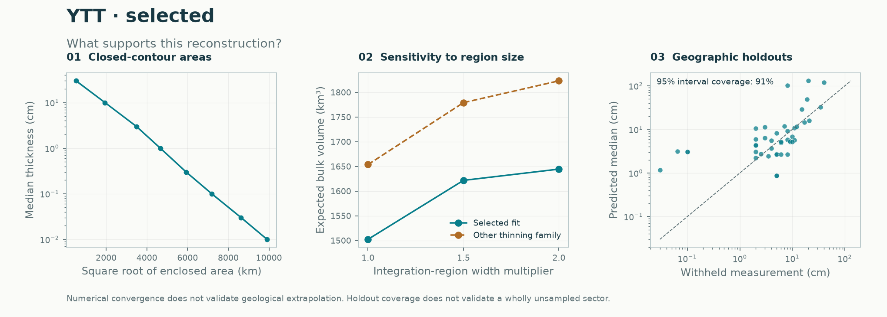

# YTT: audited thickness reconstruction

**Keep the established `selected` method as the default.** On the same 43 audited observations and the same geographic holdouts, the experimental ensemble improves point error slightly but worsens the primary predictive score and leaves coverage unchanged. Both final all-data fits produce the same thickness surface and regional volume. This application does not demonstrate a reason to replace the default.

[Audited data and exclusions](../../data/audits/YTT/README.md) · [Established-method report](main43_selected/README.md) · [Ensemble report](main43_stacked/README.md) · [Machine-readable decision](method_decision.json)



## Matched method comparison

Each observation is held out once in four geographic folds. Both methods use the same folds, a **50 km buffer** in outer and inner validation, and three inner folds for tuning. Every outer prediction refits the method on training data. Final all-data weights are not used to score those withheld observations.

| Metric | Established `selected` | Experimental `stacked` | Interpretation |
|---|---:|---:|---|
| Mean negative log score | **2.130** | 2.167 | Lower is better; ensemble worsens by 0.037 |
| Equal-region negative log score | **2.179** | 2.223 | Same direction when regions receive equal weight |
| Natural-log RMSE | 1.394 | **1.336** | Ensemble point error improves by about 4.1% |
| Nominal 95% observation coverage | 39/43 (90.7%) | 39/43 (90.7%) | No improvement |
| Mean interval width, natural-log cm | 4.806 | 4.709 | Ensemble intervals are slightly narrower |

The proper predictive score assesses the predictive distribution, rather than point predictions alone. A small RMSE gain with a worse score and unchanged coverage does not establish overall superiority. These four folds are descriptive evidence on this deposit, not a significance test or proof that the established method is universally better. The default remains unchanged and the ensemble remains available.

The ensemble's extra observation-discrepancy adjustment worsens its negative log score further to **2.332**, with the same 39/43 coverage. It remains a diagnostic; it does not alter the latent maps or volume draws.

The final all-data ensemble places **100% weight** on exactly the same exponential component selected by the established method: length factor 0.75, noise ratio 1.5. Model coefficients and exported expected-thickness grids agree. Differences between their Monte Carlo volume quantiles reflect different random-number paths, not a different fitted field. Outer validation results can differ because the models learned within individual training folds differ.

[All metrics](comparison.csv) · [Every held-out site](site_holdouts.csv) · [Results by geographic fold](fold_comparison.csv)

## The western extrapolation failure remains

Both methods miss the same four thin distal records. The western fold covers only **6/10** observations; each of the other three folds covers 11/11. Overall coverage obscures this regional weakness.

| Record | Site | Audited thickness (cm) | Established holdout median (cm) | Established 95% observation interval (cm) |
|---|---|---:|---:|---:|
| T062 | Lake Chala | 0.030 | 1.163 | 0.193–7.017 |
| T061 | SO130-284KL | 0.100 | 3.095 | 0.561–17.084 |
| T060 | SO130-289KL | 0.100 | 3.095 | 0.561–17.078 |
| N003 | SO130-287KL | 0.065 | 3.122 | 0.566–17.208 |

The fitted method substantially overpredicts these thicknesses when their region is withheld. Replacing them with pseudo-data or tuning against the outer test values would conceal the failure. Resolving it calls for a separately evaluated change to the trend, preservation/measurement model or independent evidence. Sparse distal coverage cannot identify arbitrary unobserved deposit structure.



## Regional bulk volumes and audit sensitivity

All four calculations use the same source-centred Lambert azimuthal equal-area volume rectangle: **easting −6,900 to 2,400 km; northing −1,400 to 2,900 km**. It is a stated comparison region, not a mapped deposit boundary. The source reference is the audited Toba caldera coordinate, not an established unique YTT vent.

| Input and method | Records | Expected regional bulk volume (km³) | Median-surface integral (km³) | Report |
|---|---:|---:|---:|---|
| Main audit, established | 43 | **1,502.3** | 1,313.9 | [Read](main43_selected/README.md) |
| Main audit, ensemble | 43 | 1,502.3 | 1,313.9 | [Read](main43_stacked/README.md) |
| Exclude five MD161 additions, ensemble | 38 | 1,493.6 | 1,304.4 | [Read](no_md16138_stacked/README.md) |
| Add two Maninjau records, ensemble | 45 | 1,477.9 | 1,313.1 | [Read](with_maninjau45_stacked/README.md) |

Removing the five MD161 beds changes expected volume by −0.6%; adding Maninjau changes it by −1.6%. These are specific data-selection sensitivities, not uncertainty bounds. Their validation folds are recomputed on different observations, so their scores cannot establish improvement over the 43-record case.

For the main fit, about **19%** of expected regional volume is outside the observation hull. Doubling both region widths raises expected volume to **1,644.5 km³**. Alternative power-law tails give higher volumes; see the [domain/family table](main43_selected/volume_summary.csv). These comparisons are not confidence intervals.

The refined main integral converges at 128×128 cells, with a 0.014% change from the previous grid. Closed median isopachs are resolved from 0.01 to 30 cm. Requested 100 and 300 cm levels exceed the resolved model peak, so no contours are fabricated. Low contour levels extrapolate far into unsampled sectors; geometric closure does not validate them.

**None of these volumes is total erupted volume or dense-rock equivalent.** Intervals condition on fitted parameters and selection/weights, and omit parameter uncertainty. Audit selection, preservation and source-position uncertainties are not fully propagated. The nearest measurement is hundreds of kilometres from the caldera; this dataset alone does not constrain proximal deposit structure adequately.

## Exactly what was fitted

The unchanged audit workbook contains 88 records. The main input is every nonblank audited `fit_cm` entry: **43 observations**, including retained qualified beds. All 88 original rows, references, evidence notes and model-row mappings are preserved in the [manifest](../../data/audits/YTT/selection_manifest.csv).

The 38-record case excludes N021–N025, five bioturbated Mahanadi beds. The 45-record case adds N001/N002 at the reported 23 cm using approximate coordinates, as an explicit sensitivity override. Neither override changes the main input. Huguangyan and Malawi illustrative/assumed values are excluded; a hypothetical Huguangyan 0.05 cm is not measured thickness. Chala remains gross preserved-deposit thickness, and RC14-37 uses observed 15 cm. Reported ranges are not converted into invented measurement uncertainties. No pseudo-observations or undocumented non-detections enter the calculation.

## Reproduce and inspect

From the repository root, after installing `.[test]`:

```sh
python -m benchmarks.ytt --output results/ytt
python -m pytest -q
```

The reproduction command rebuilds all three input selections in memory from the workbook, verifies exact SHA-256 checksums and the manifest, and then runs all four calculations. It refuses nonempty output directories. Each run records source/input hashes, fitted parameters, package versions, settings and held-out predictions. The source hashes identify the code used even when the report was generated before its publication commit.

Published settings: 4 outer/3 inner folds; 50 km validation buffer; 128×128 exported prediction grid; 481×481 contour grid with local refinement when needed; 48×48 joint-volume grid; 1,500 draws; seed 1729; maximum map coordinate 8,000 km. The numerical integral uses separate adaptive grid refinement.

Each report folder contains a GitHub-readable README, map PNG/PDF, diagnostic PNG, GeoJSON contours, observation/area/volume tables and full numerical JSON. SVG, optional HTML, dense prediction CSV and joint-distribution NPZ exports can be regenerated locally and are omitted here to keep the repository manageable. **41 automated checks passed**, including exact audit reconstruction, input-change detection, profile overrides and the existing numerical/statistical tests. The clean installation was also checked outside the repository.

Future eruptions follow the same workflow: upload data and source notes in chat; the assistant checks them and publishes accepted inputs, explicit assumptions, validation and reports here. The browser upload server has been removed.
