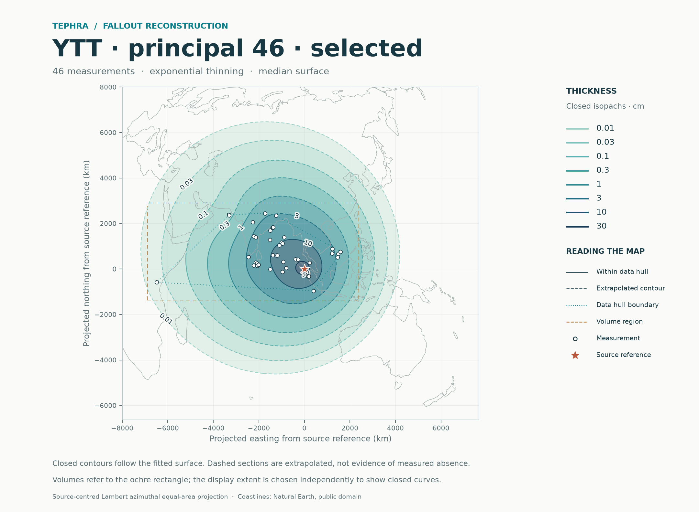
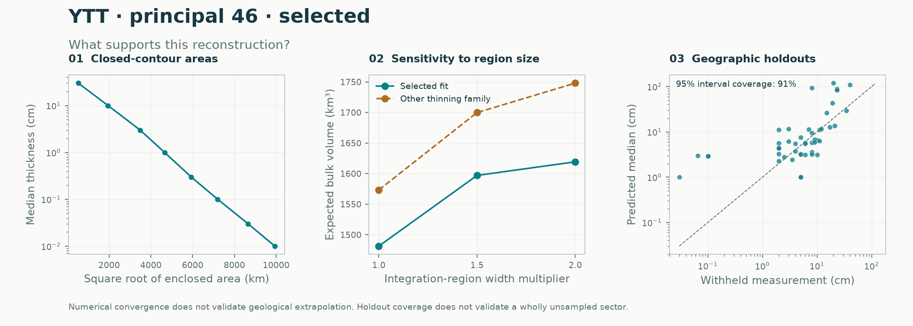

# YTT: reviewed principal dataset

**Historical regional calculation · Gaussian-process model.** These volumes use a stated rectangle. [Current eruption report](../README.md) · [Report catalogue](../../README.md). The source-selection sensitivities below remain useful; their regional headlines are not the current global headline.

**The principal dataset now contains 46 observations:** the original 43, Maninjau A40/A64 at approximately 23 cm each, and newly verified **U1445B at 8 cm**. The five MD161 beds were already principal observations. Every one of the 88 audited records has an explicit [review decision](../../../data/audits/YTT/record_review.csv).

The expected regional bulk-fallout volume is **1,481.3 km³**. Adding U1445B changes the preceding 45-record result by **+3.5 km³ (+0.24%)**. Geological evidence determines inclusion; neither improved scores nor agreement with a target volume is an inclusion criterion.

[Input audit and primary sources](../../../data/audits/YTT/README.md) · [Principal data](../../../data/eruptions/YTT_tephra.csv) · [Selected calculation](principal/selected/README.md) · [Ensemble calculation](principal/stacked/README.md) · [Earlier versions](../archive/README.md)



## Source decisions

- **Maninjau N001/N002 remain principal:** documented primary airfall; thicknesses and approximate positions retain their qualifications. Their location uncertainty is not propagated into the intervals.
- **U1445B N005 is promoted:** Kutterolf et al. (2023), Table 1 p. 18, identifies a discrete 8 cm YTT bed with a horizontal base. Hole coordinates were checked in IODP Table T1. Disturbed companion U1445A remains excluded, giving one representative at the site.
- **MD161 N021–N025 remain principal:** the exclusion sensitivity tests their influence; it does not classify them as absent from the main dataset.
- **U1448B N006 remains sensitivity-only:** the later 20 cm section and shipboard 56 cm interval have unresolved contact definitions, with an irregular base. This difference is not treated as a statistical error bar.
- Other held records retain individual reasons: unresolved correlation, reworking, disturbance, uncertain contacts/locations, unverified original tables, or mixed sampling intervals. Missing evidence never becomes a zero-thickness point.

See the [audit](../../../data/audits/YTT/README.md) for citations and evidence scope. All 88 records were screened, with targeted new primary-source checks; the remaining original-paper assessments are inherited from the prior audit. The source workbook is unchanged. Reviewed overrides and effective coordinates are separate, reproducible fields.

## Regional volume and selection sensitivities

All cases use the same stated equal-area rectangle: eastings −6,900 to 2,400 km and northings −1,400 to 2,900 km from the Toba reference coordinate. Sensitivity rows below use the selected method.

| Input | Records | Expected bulk volume, km³ | Median-surface integral, km³ |
|---|---:|---:|---:|
| [Principal](principal/selected/README.md) | 46 | **1,481.3** | 1,315.9 |
| [Without Maninjau](sensitivity/without_maninjau/README.md) | 44 | 1,505.9 | 1,316.5 |
| [Without U1445B](sensitivity/without_u1445b/README.md) | 45 | 1,477.9 | 1,313.1 |
| [Without MD161](sensitivity/without_md161/README.md) | 41 | 1,473.1 | 1,305.2 |
| [With disputed U1448B](sensitivity/with_u1448b/README.md) | 47 | 1,491.8 | 1,329.3 |

These are finite-region bulk-deposit volumes, not total erupted volumes or dense-rock equivalents. About **19.2%** of expected principal-region volume lies outside the observation hull. Doubling both region widths increases the estimate to **1,619.2 km³**. The last integral refinement changes the estimate by **0.013%**, meeting the 0.5% numerical criterion. These checks do not resolve preservation or unsampled-tail uncertainty.

The conditional joint-volume simulation gives a central 95% interval of approximately **976–2,169 km³** (1,500 draws on a 48×48 grid). Fitted-parameter and position uncertainty are omitted, and quantile grid convergence is not established. The integral of the median thickness surface is not the median of random total volume.

## Matched geographic validation

Principal selected and stacked methods use identical 46 observations and four outer geographic folds, with three inner folds and a 50 km buffer. Maninjau sections are withheld together. Ensemble weights for each outer prediction use only its training data.

| Holdout metric | Selected | Stacked |
|---|---:|---:|
| Negative log score; lower is better | 2.055 | **2.034** |
| Equal-region negative log score | 2.086 | **2.064** |
| Natural-log RMSE | 1.342 | **1.274** |
| Nominal 95% observation coverage | 42/46 (91.3%) | 42/46 (91.3%) |
| Mean interval width, natural-log cm | 4.746 | 4.686 |

The ensemble has a small proper-score advantage and lower point error, with unchanged coverage. It improves one geographic fold, slightly worsens the western fold and ties the other two. Four folds on this one eruption do not establish general superiority. This data-review revision retains the established selected default and reports both methods. The final all-data ensemble assigns 100% weight to the selected exponential component: coefficients, expected-thickness grids and expected regional volumes agree. Small simulation-quantile differences reflect sampling paths. Extra ensemble discrepancy adjustment worsens the score to 2.191 and remains diagnostic.

Comparisons between different record selections are not matched validation experiments: adding a record can change geographic partitions and training fits. U1448B's better score does not resolve its conflicting geological interpretation.

[All metrics](comparison.csv) · [Every held-out observation](site_holdouts.csv) · [Fold summaries](fold_comparison.csv) · [Recorded method decision](method_decision.json)



Both methods miss four western thin records: Lake Chala, SO130-284KL, SO130-289KL and SO130-287KL. Selected-method holdout prediction for U1445B has median **3.6 cm**, with a broad **0.45–29 cm** interval containing its 8 cm observation. The Maninjau medians are about **83 and 89 cm** against approximately 23 cm observed, with broad intervals of about **4–1,660 and 4–1,774 cm**. Coverage here does not imply precise prediction.

## Organization and reproduction

`principal/` contains selected and ensemble reports. `sensitivity/` contains four explicitly named inclusion/exclusion experiments. `archive/` preserves the original 43-record and intermediate 45-record calculations. Each current run includes maps, a PDF, GIS contours, full numerical JSON and observation/area/volume tables; dense regenerable arrays remain in ignored `results/`.

```sh
python -m pip install '.[test]'
python -m benchmarks.ytt --prepare-only
python -m benchmarks.ytt --output results/ytt
python -m pytest -q
```

Use a new output directory. The benchmark verifies the unchanged workbook, all 88 reviewed rows, deterministic selections and historical input hashes before running six calculations. `tephra-isopachs fit YTT` resolves the principal 46-record input. Settings remain a 128×128 prediction grid, 481×481 contour grid, 48×48 volume grid, 1,500 draws, seed 1729 and 8,000 km contour limit. Input, provenance, model-source and benchmark hashes are recorded. The existing historical 43-record fit is checked to remain numerically unchanged.
