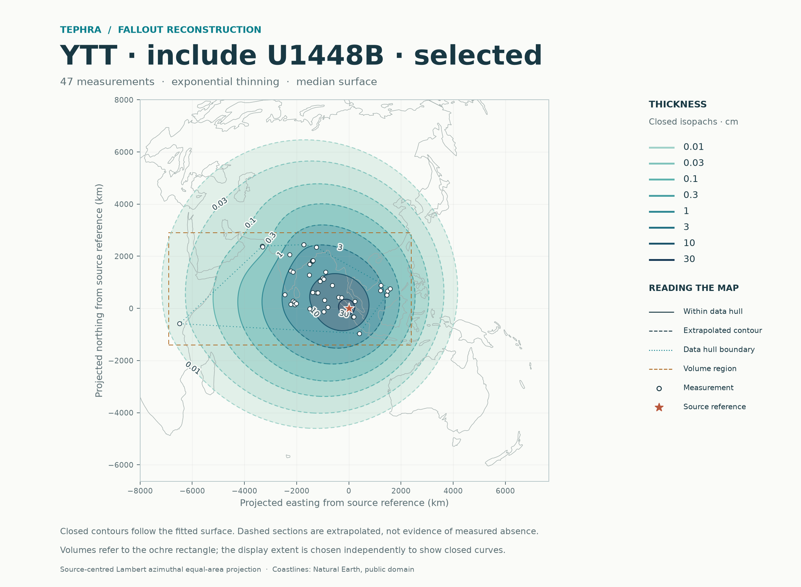
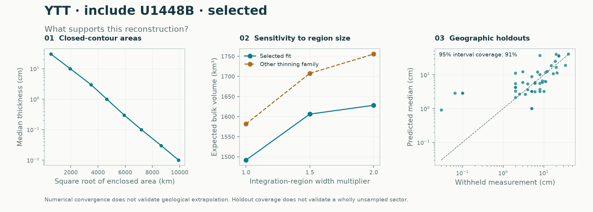

# YTT · include U1448B · selected: deposit reconstruction

**Method: selected Gaussian process (`selected`) · historical regional calculation.** [Method guide](../../../../../docs/METHODS.md) · [Report catalogue](../../../../README.md)

The analysis used **47 thickness measurements** and 0 documented upper limits and 0 lower bounds, excluding 0 legacy pseudo rows. Spatial validation selected the exponential thinning family within the directional-trend-plus-spatial-residual model.

| Result | Estimate |
|---|---:|
| Expected bulk volume in the stated region | 1,491.8 km³ |
| Integral of the median thickness surface | 1,329.3 km³ |
| Expected volume outside the observation hull | 19% |
| Expected volume after doubling both region widths | 1,628.1 km³ |
| Last numerical refinement change | 0.01% |

Closed median isopachs were resolved at 0.01, 0.03, 0.1, 0.3, 1, 3, 10, 30 cm. Extrapolated contour sections are dashed on the map.

Nested geographic holdouts covered 91% of exact measurements with nominal 95% intervals; natural-log RMSE was 1.23.

| Geographic holdout metric | Value |
|---|---:|
| Negative log score (lower is better) | 1.962 |
| Equal-region negative log score | 2.002 |
| Mean 95% interval width (natural-log cm) | 4.651 |

These are finite-region **bulk deposit volumes**, not total erupted volumes or DRE. The median-surface integral is not the median of total random volume. The stated equal-area rectangle is easting -6900 to 2400 km and northing -1400 to 2900 km from the supplied source reference. Numerical convergence passed the 0.5% criterion. Unsampled sectors and distant tails remain assumption-dependent. Uncertainty model: conditional Gaussian. Fitted-parameter uncertainty is not integrated. Input selection preserves the supplied audit: Principal plus disputed U1448B 20 cm (47); tests inclusion, does not resolve contacts. Geological qualifications remain in the source audit; this model run does not re-audit the original publications.

[Numerical report](report.json) · [Map PDF](isopachs.pdf) · [Volume table](volume_summary.csv) · [Contours](isopachs.geojson)

