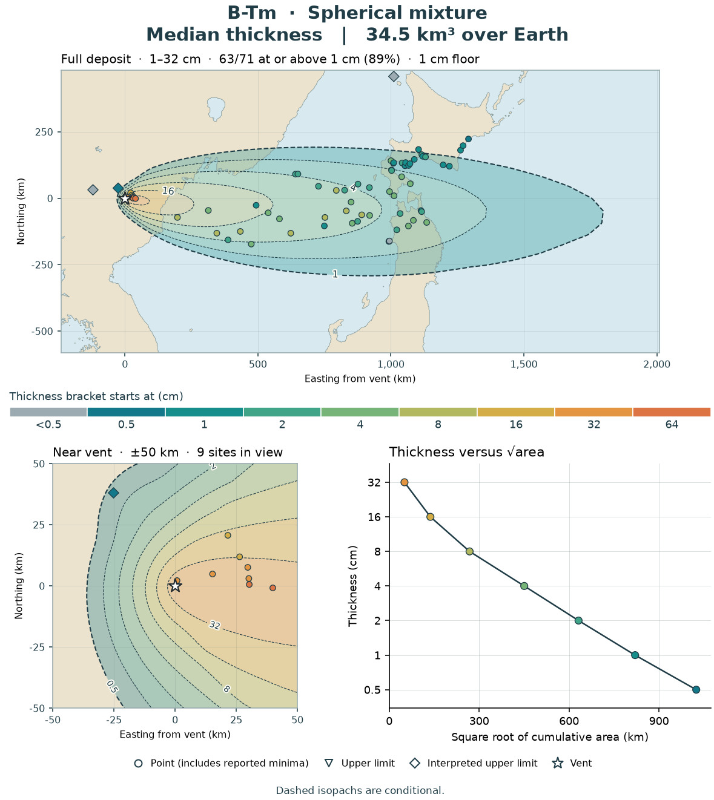

# B-Tm spherical median thickness

This map uses the completed four-chain full-data fit. All three field-reported lower limits enter as point measurements. The final attempt passed the baseline sampling checks. The complete model comparison also includes eight fixed prior fits and four geographic holdouts. [Underlying posterior and validation run](https://github.com/siyulai21/tephra-fallout-isopachs/actions/runs/45669570647)

[Thickness grid and source identities](deposit.json) · [Thickness and area](thickness-area.csv)
